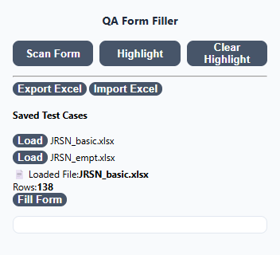
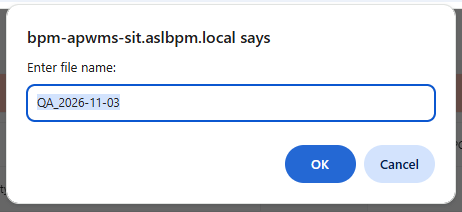
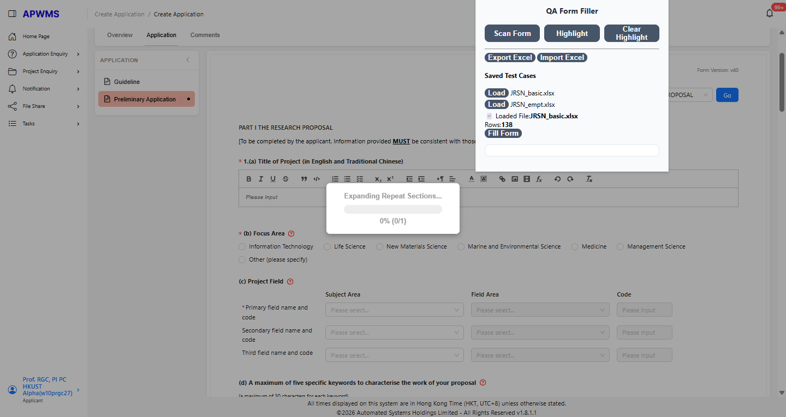

# QA Form Filler

Chrome extension for exporting, importing, and managing APWMS form test cases using Excel.

## Features

### Form Automation

- Export form data to Excel
- Import form data from Excel
- Fill forms from imported Excel data
- Excel structure validation

### Repeat Section Support

- Automatic repeat section expansion
- Automatic repeat section cleanup
- Keyword section support

### Test Case Management

- Save imported Excel files as test cases
- Persistent test case storage
- Load and reuse imported data
- Foundation for multiple test case support

### User Experience

- Import progress indicator
- Import file tracking
- Custom export file names

## Installation

1. Download the release package.
2. Open Chrome Extensions.
3. Enable Developer Mode.
4. Click **Load unpacked**.
5. Select the extension folder.

## Usage

### Export

1. Open an APWMS form.
2. Click **Export Excel**.
3. Save the generated Excel file.

### Import

1. Open an APWMS form.
2. Click **Import Excel**.
3. Select an Excel file.
4. The file will be loaded and saved as a test case.

### Fill Form

1. Import or load a test case.
2. Click **Fill Form**.
3. The extension will populate the APWMS form using the loaded data.

## Roadmap

### v1.5.0

- Test case list UI
- Load test case buttons
- Delete test case support

### Future

- Multiple test cases
- Folder import
- Batch test execution
- Test case categories
- Search and filtering

## Changelog

See [CHANGELOG.md](CHANGELOG.md).